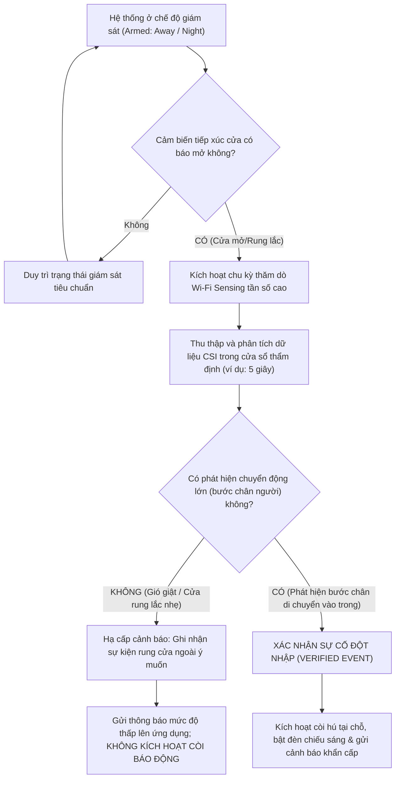

# BÁO CÁO PHÂN TÍCH KỸ THUẬT: CƠ CHẾ VẬN HÀNH & KIẾN TRÚC HỆ THỐNG WI-FI SENSING THƯƠNG MẠI

> **Loại tài liệu**: Báo Cáo Phân Tích Kỹ Thuật & Khảo Sát Hệ Thống (Technical System Evaluation)  
> **Chuyên đề**: Khảo sát & Đánh giá Cơ chế Triển khai Thực tế của Công nghệ Wi-Fi Sensing  
> **Thời điểm cập nhật**: Tháng 11/2026  
> **Đối tượng tài liệu**: Kỹ sư Hệ thống Vô tuyến, Kiến trúc sư IoT, Kỹ sư Phát triển Sản phẩm Mạng

---

## MỤC LỤC TỔNG QUAN

1. [Tổng Quan Kỹ Thuật Về Wi-Fi Sensing](#1-tổng-quan-kỹ-thuật-về-wi-fi-sensing)
   - 1.1 Khái niệm & Cơ chế tương tác giữa cơ thể người với sóng vô tuyến
   - 1.2 Hai ranh giới kỹ thuật: Môi trường phòng lab vs Môi trường thực tế
2. [Nguyên Lý Thu Thập & Đặc Tính Tín Hiệu Sóng](#2-nguyên-lý-thu-thập--đặc-tính-tín-hiệu-sóng)
   - 2.1 Mô hình liên kết vô tuyến (Tx - Rx Links)
   - 2.2 So sánh tín hiệu: RSSI vs. CSI (Làm rõ cấu trúc sóng mang con và số điểm đo)
   - 2.3 Cơ chế thăm dò tích cực & Thách thức từ quản lý năng lượng của thiết bị di động
   - 2.4 Ranh giới năng lực kỹ thuật: Chuyển động lớn (Macro) vs. Chuyển động nhỏ (Micro)
3. [Khảo Sát Một Số Mô Hình Triển Khai Thực Tế](#3-khảo-sát-một-số-mô-hình-triển-khai-thực-tế)
   - 3.1 Tích hợp trên gateway mạng gia đình: Trường hợp Comcast Xfinity WiFi Motion
   - 3.2 Phát hiện chuyển động điều khiển chiếu sáng: Trường hợp WiZ SpaceSense (Signify)
   - 3.3 Bài học kỹ thuật từ thử nghiệm trước đây: Trường hợp Linksys Aware (2019–2024)
4. [Mô Hình Phối Hợp Đa Cảm Biến Trong Hệ Thống An Ninh](#4-mô-hình-phối-hợp-đa-cảm-biến-trong-hệ-thống-an-ninh)
   - 4.1 Kiến trúc an ninh đa tầng tổng quát (Ngoại vi - Lối vào - Điểm mù riêng tư)
   - 4.2 Cơ chế xác thực kích hoạt kép (Dual-Trigger Logic)
5. [Đánh Giá Mức Độ Sẵn Sàng Công Nghệ (TRL) Theo Chức Năng](#5-đánh-giá-mức-độ-sẵn-sàng-công-nghệ-trl-theo-chức-năng)
   - 5.1 Phân loại TRL theo từng nhóm chức năng kỹ thuật
   - 5.2 Các yếu tố kỹ thuật gây báo động giả trong môi trường triển khai thực tế

---

## 1. TỔNG QUAN KỸ THUẬT VỀ WI-FI SENSING

### 1.1 Khái niệm & Cơ chế tương tác giữa cơ thể người với sóng vô tuyến

**Wi-Fi Sensing** (Cảm biến nhận thức qua sóng Wi-Fi) là công nghệ phần mềm khai thác sự biến đổi của trường sóng vô tuyến giữa các trạm phát (Access Point / Router) và các thiết bị thu nhận trong mạng Wi-Fi sẵn có để nhận biết chuyển động hoặc hiện diện trong không gian.

Trong không gian kín của căn hộ hay văn phòng, sóng vô tuyến tần số 2.4 GHz và 5 GHz lan truyền theo nhiều ngả đường khác nhau (Multipath Propagation): bao gồm tia truyền thẳng trực tiếp (Line-of-Sight - LoS) và hàng loạt tia phản xạ, tán xạ, nhiễu xạ từ tường, sàn, trần và các bề mặt đồ vật. Tập hợp các tia này giao thoa với nhau, tạo thành một trường sóng phức tạp tại ăng-ten đầu thu.

```
                  ┌─────────────────────────────────────┐
                  │          TRẦN NHÀ & TƯỜNG           │
                  └──────────────┬───────────────┬──────┘
                   Tia phản xạ 1 │               │ Tia phản xạ 2
                                 ▼               ▼
┌──────────────────┐         ┌───────────────────────┐         ┌──────────────────┐
│  BỘ PHÁT (Tx)    ├────────►│   CƠ THỂ CON NGƯỜI    ├────────►│   BỘ THU (Rx)    │
│  (Router/Gateway)│ LoS     │ - Mô sinh học hấp thụ │         │ (Router/Node/    │
│                  │ Trực    │   & làm lệch pha sóng │         │  Thiết bị IoT)   │
└──────────────────┘ tiếp    └───────────────────────┘         └────────┬─────────┘
                                                                        │
                                       Trích xuất CSI từ tầng PHY của Rx│
                                                                        ▼
                                                       ┌────────────────┴─────────┐
                                                       │    BỘ XỬ LÝ TÍN HIỆU     │
                                                       │  - Lọc trôi pha CFO/SFO  │
                                                       │  - Phân tích Doppler     │
                                                       │  - Nhận diện chuyển động │
                                                       └──────────────────────────┘
```

Về cơ chế tương tác vật lý:
- **Đặc tính điện môi của mô sinh học**: Cơ thể con người là một vật thể có hằng số điện môi cao do chứa hàm lượng lớn nước và các chất điện giải. Ở các băng tần Wi-Fi (2.4 GHz và 5 GHz), các mô sinh học gây ra hiện tượng suy hao hấp thụ (dielectric absorption) và làm tán xạ năng lượng sóng vô tuyến.
- **Biến dạng trường giao thoa**: Khi một người bước đi hoặc di chuyển các chi trong phòng, người đó cắt ngang hoặc làm thay đổi đường đi của các tia phản xạ (vùng Fresnel). Sự thay đổi này làm lệch pha (phase shift), thay đổi biên độ (amplitude attenuation) và tạo ra hiệu ứng dịch chuyển Doppler (Doppler shift) trên các thành phần sóng mang nhận được tại đầu thu.

Chuỗi khối chức năng xử lý tín hiệu thông thường bao gồm:
1. *Nguồn phát tín hiệu vô tuyến (Tx)*: Phát các gói tin Wi-Fi định kỳ vào môi trường.
2. *Môi trường truyền sóng*: Không gian diễn ra tương tác vật lý giữa sóng vô tuyến và vật thể chuyển động.
3. *Khối trích xuất kênh truyền (Rx)*: Chipset vô tuyến ở đầu thu trích xuất dữ liệu trạng thái kênh tại tầng vật lý (PHY layer).
4. *Khối lọc nhiễu & Chuẩn hóa*: Khắc phục các sai số phần cứng nội tại như trôi tần số sóng mang (Carrier Frequency Offset - CFO), trôi tần số lấy mẫu (Sampling Frequency Offset - SFO), và trôi pha ngẫu nhiên giữa các gói tin.
5. *Khối phân tích đặc trưng*: Trích xuất các tham số biến thiên năng lượng, phương sai pha và phổ Doppler để đưa ra trạng thái chuyển động.

---

### 1.2 Hai ranh giới kỹ thuật: Môi trường phòng lab vs Môi trường thực tế

Để thiết kế hệ thống chính xác, cần nhìn nhận khách quan hai ranh giới kỹ thuật chi phối hiệu năng thực tế của Wi-Fi Sensing:

#### Ranh giới 1: Khoảng cách giữa phòng thí nghiệm và hiện trường căn hộ thực tế
Nhiều nghiên cứu học thuật trong điều kiện thực nghiệm lý tưởng ghi nhận độ chính xác cao. Tuy nhiên, các kịch bản này thường được thực hiện trong môi trường kiểm soát chặt chẽ: phòng trống ít đồ đạc, cự ly trực diện ngắn (2–3 m), chỉ một người chuyển động theo quỹ đạo cố định, kênh sóng sạch và thiết bị client cắm sạc liên tục phát gói tin đều đặn.

Khi triển khai ra căn hộ thực tế, hệ thống phải đối mặt với nhiều rào cản môi trường:
- **Suy hao truyền qua vật cản phụ thuộc điều kiện thực tế**: Mức độ suy hao sóng khi đi qua tường phụ thuộc chặt chẽ vào vật liệu (bê tông đặc, gạch rỗng, thạch cao), độ dày kết cấu và tần số sóng (sóng 5 GHz suy hao qua tường lớn hơn đáng kể so với 2.4 GHz). Khi đi qua nhiều bức tường dày, tín hiệu bị suy giảm mạnh khiến SNR giảm sâu, làm méo mó các thành phần thông tin kênh.
- **Can nhiễu đa mạng**: Trong các khu chung cư hay văn phòng, hàng chục mạng Wi-Fi lân cận hoạt động đồng kênh hoặc kênh kế cận, gây xung đột khung truyền và làm tăng nhiễu nền vô tuyến.
- **Vật thể chuyển động trong môi trường**: Chuyển động của vật nuôi, rèm cửa đung đưa do gió điều hòa, quạt trần quay hoặc robot hút bụi tự hành đều tạo ra các biến động trường sóng, dễ gây ra hiện tượng kích hoạt sai (False Positives).
- **Cơ chế quản lý năng lượng của thiết bị di động**: Hệ điều hành trên smartphone (iOS, Android) tự động điều tiết kết nối khi khóa màn hình, làm chuỗi gói tin nhận được bị ngắt quãng, không đảm bảo tần số lấy mẫu đều đặn.

#### Ranh giới 2: Wi-Fi Sensing là Lớp cảm biến hỗ trợ phụ trợ (Auxiliary Layer)
Với đặc thù vật lý của sóng vô tuyến và các nguồn nhiễu thực tế, Wi-Fi Sensing trong các hệ thống thương mại không được thiết kế để thay thế hoàn toàn camera giám sát hay cảm biến chuyên dụng. 

Thay vào đó, công nghệ này phát huy hiệu quả ở vai trò **lớp cảm biến phụ trợ bổ sung**:
- *Hỗ trợ điểm mù camera*: Giám sát chuyển động tại các khu vực nhạy cảm cần bảo đảm quyền riêng tư cá nhân (như phòng ngủ, phòng tắm, phòng thay đồ) – những nơi không được phép lắp đặt camera giám sát.
- *Hỗ trợ phát hiện chuyển động lớn khi nhà vắng*: Xác định có bước chân người đi lại hoặc mở cửa lớn trong nhà khi toàn bộ người dùng đã rời đi (chế độ Vắng nhà), đóng vai trò kích hoạt lớp xác minh an ninh ban đầu hoặc điều khiển tự động hóa.

---

## 2. NGUYÊN LÝ THU THẬP & ĐẶC TÍNH TÍN HIỆU SÓNG

### 2.1 Mô hình liên kết vô tuyến (Tx - Rx Links)

Hệ thống Wi-Fi Sensing vận hành dựa trên các **cặp liên kết vô tuyến (Radio Links)** giữa thiết bị phát (Tx) và thiết bị thu (Rx).

```
                      ┌────────────────────────┐
                      │  ROUTER GATEWAY (AP)   │
                      │ Đóng vai trò Bộ thu Rx │
                      └───────────┬────────────┘
                                  │
         ┌────────────────────────┼────────────────────────┐
         │ Link 1                 │ Link 2                 │ Link 3
         ▼                        ▼                        ▼
┌─────────────────┐      ┌─────────────────┐      ┌─────────────────┐
│ Smart TV        │      │ Loa thông minh  │      │ Ổ cắm thông minh│
│ (Node phát Tx1) │      │ (Node phát Tx2) │      │ (Node phát Tx3) │
│ [Cố định 220V]  │      │ [Cố định 220V]  │      │ [Cố định 220V]  │
└─────────────────┘      └─────────────────┘      └─────────────────┘
```

Trong kiến trúc mạng gia đình điển hình:
- **Router Gateway (AP)**: Thường đóng vai trò thiết bị thu thập chính (Rx). Do sở hữu tài nguyên CPU và bộ nhớ lớn hơn các thiết bị IoT đầu cuối, Router đảm nhận việc trích xuất thông tin kênh và thực thi các thuật toán xử lý tín hiệu.
- **Các thiết bị đầu cuối cố định (Fixed Clients)**: Smart TV, loa thông minh, ổ cắm thông minh hoặc công tắc thông minh cắm điện lưới liên tục. Những thiết bị này có vị trí cố định, tạo ra các đường liên kết không gian ổn định làm mốc đo đạc trường sóng.

---

### 2.2 So sánh tín hiệu: RSSI vs. CSI (Làm rõ cấu trúc sóng mang con và số điểm đo)

Để theo dõi biến động môi trường, hai nguồn dữ liệu vô tuyến có thể được trích xuất từ thiết bị Wi-Fi:

| Tiêu chí kỹ thuật | RSSI (Received Signal Strength Indicator) | CSI (Channel State Information) |
| :--- | :--- | :--- |
| **Bản chất đo đạc** | Giá trị vô hướng (scalar), thể hiện tổng công suất tín hiệu nhận được trên toàn bộ kênh tần số (đơn vị dBm). | Ma trận số phức (complex matrix), thể hiện đáp ứng tần số kênh truyền (biên độ và pha) trên từng sóng mang con riêng biệt. |
| **Độ phân giải thông tin** | Rất thấp: Chỉ là 1 giá trị công suất gộp cho mỗi khung truyền nhận được. | Cao: Cung cấp thông tin chi tiết đa chiều theo từng cặp ăng-ten thu-phát ($N_{tx} \times N_{rx}$) và theo từng sóng mang con. |
| **Độ nhạy với chuyển động** | Kém: Khi người di chuyển, sự giao thoa giữa các tia phản xạ có thể triệt tiêu hoặc cộng hưởng ngẫu nhiên, khiến RSSI ít biến đổi hoặc bị chìm trong nhiễu. | Rất nhạy: Chỉ cần một bước chân lệch vị trí, biên độ và góc pha của các sóng mang con tương ứng lập tức biến đổi rõ rệt. |
| **Cấu trúc tần số & Điểm đo** | Không phân tách tần số. | Phân tách theo sóng mang con (OFDM subcarriers).<br>*Lưu ý về số lượng điểm CSI*: Cần phân biệt giữa cấu trúc chuẩn (ví dụ chuẩn 802.11n 20 MHz có 64 FFT tones: gồm 52 data tones, 4 pilot tones, 1 DC và các guard tones) với **số lượng điểm CSI thực tế mà driver/chipset trích xuất** (ví dụ: công cụ Intel 5300 trích xuất 30 nhóm tone, Atheros trích xuất 56 tone). Số điểm CSI thực tế phụ thuộc trực tiếp vào firmware và driver của từng nhà sản xuất chip. |
| **Yêu cầu hỗ trợ phần cứng** | Có sẵn trên hầu hết mọi thiết bị Wi-Fi tiêu chuẩn qua tập lệnh API thông thường. | Yêu cầu firmware và driver của chip Wi-Fi hỗ trợ mở quyền trích xuất dữ liệu tầng PHY (Qualcomm, Broadcom, Intel, MaxLinear...). |

*Nhận định kỹ thuật*: Việc chỉ dựa vào RSSI để phát hiện chuyển động thường mang lại độ tin cậy thấp do công suất gộp dễ bị nhiễu và không bóc tách được các thành phần đa đường. Các giải pháp thương mại ổn định hiện nay đều xây dựng trên việc phân tích dữ liệu kênh chi tiết (CSI hoặc tương đương).

---

### 2.3 Cơ chế thăm dò tích cực & Thách thức từ quản lý năng lượng của thiết bị di động

#### Cơ chế phát gói tin thăm dò tích cực (Active Probing)
Khi người trong nhà không sử dụng Internet (không có luồng truyền tải dữ liệu người dùng), mạng Wi-Fi sẽ ở trạng thái rảnh rỗi. Khi không có gói tin truyền nhận, đầu thu Rx không thể cập nhật thông tin trạng thái kênh để theo dõi chuyển động.

Để duy trì việc giám sát, hệ thống triển khai cơ chế **Active Probing**:
- Router chủ động gửi định kỳ các khung truyền thăm dò (như khung rỗng *Null Data Packet*, khung điều khiển *QoS Null*, hoặc bản tin kiểm tra tầng mạng *ARP Ping*) đến các thiết bị trong mạng.
- Thiết bị nhận phản hồi bằng khung ACK hoặc gói tin trả lời, qua đó đầu thu trích xuất được ma trận CSI tại thời điểm đó.

```
Router Gateway (Rx)                                         Thiết bị Đầu cuối (Tx)
        │                                                              │
        │── Khung QoS Null Frame (Chu kỳ định kỳ) ────────────────────►│
        │◄─ Khung ACK / Phản hồi tầng PHY ─────────────────────────────│
        │                                                              │
[Trích xuất CSI từ Header PHY của phản hồi]                            │
[Đưa ma trận CSI vào bộ đệm phân tích]                                 │
```

*Lưu ý về tần số lấy mẫu (Sampling Rate)*:
- Tần số thăm dò thường được cấu hình trong khoảng **10 Hz đến 30 Hz** (10–30 gói/giây).
- Tuy nhiên, việc nhận diện bước chân người trong thực tế **không thể chỉ kết luận đơn giản dựa trên định lý lấy mẫu Nyquist đối với tần số bước chân** (nhịp chân đi khoảng 1.5–2 Hz). Khi một người di chuyển, cử động vung tay và vung chân tạo ra các dịch chuyển Doppler phức tạp có phổ tần số trải rộng đến hàng chục Hz. Đồng thời, việc xử lý còn phụ thuộc vào độ trễ bộ đệm, SNR của từng sóng mang con và thuật toán trích xuất đặc trưng thời gian - tần số. Tần số thăm dò cần được cân bằng giữa độ mịn của phổ Doppler và mức chiếm dụng tài nguyên kênh truyền.

#### Thách thức từ cơ chế quản lý năng lượng của điện thoại thông minh
Nhiều thử nghiệm đặt câu hỏi liệu có thể dùng điện thoại di động (smartphone) làm đối tác liên kết liên tục để nhận diện chuyển động hay không. Trên thực tế triển khai, điều này gặp trở ngại lớn:
- **Cơ chế quản lý năng lượng (Power Management / Doze Mode)**: Smartphone không phải lúc nào cũng ngắt hoàn toàn kết nối Wi-Fi khi tắt màn hình, nhưng các hệ điều hành di động (iOS, Android) tự động kích hoạt các chính sách tiết kiệm pin nghiêm ngặt: giãn chu kỳ thức dậy nhận gói (DTIM), tạm dừng các tiến trình chạy ngầm, và chỉ kích hoạt truyền gói tin định kỳ không liên tục. Điều này khiến chuỗi lấy mẫu CSI bị đứt đoạn, khoảng cách giữa các gói tin không đều đặn, gây khó khăn lớn cho việc tính toán biến thiên trường sóng liên tục.
- **Ngẫu nhiên hóa địa chỉ MAC**: Cơ chế bảo mật ngẫu nhiên hóa MAC trong quá trình quét mạng làm phức tạp thêm việc quản lý phiên cảm biến ổn định.

*Giải pháp trong thực tế*: Các hệ thống thương mại ưu tiên lựa chọn **các thiết bị cắm nguồn điện cố định (Mains-powered static devices)** như Smart TV, loa thông minh, ổ cắm thông minh hoặc giữa các trạm mạng Mesh với nhau. Các thiết bị này không bị giới hạn bởi chế độ ngủ sâu tiết kiệm pin và có vị trí không gian cố định, đảm bảo chuỗi đo đạc ổn định.

---

### 2.4 Ranh giới năng lực kỹ thuật: Chuyển động lớn (Macro) vs. Chuyển động nhỏ (Micro)

Năng lượng biến thiên của trường sóng phụ thuộc trực tiếp vào kích thước hình học và biên độ dịch chuyển của vật thể:

```
Năng lượng biến thiên CSI
      ▲
      │       ┌────────────────────────────────────────────────────────┐
 Cao  │       │ NHÓM CHUYỂN ĐỘNG LỚN (MACRO-MOTION)                    │
      │       │ - Người bước đi, chạy nhảy, mở/đóng cửa lớn            │
      │       │ - Tín hiệu vượt trội so với sàn nhiễu môi trường       │
      │       │ - ĐÃ TRIỂN KHAI THƯƠNG MẠI ỔN ĐỊNH                     │
      │       └────────────────────────────────────────────────────────┘
      │
      │ - - - - - Ngưỡng phân định năng lực thực tế - - - - - - - - - -
      │
      │       ┌────────────────────────────────────────────────────────┐
      │       │ NHÓM CHUYỂN ĐỘNG NHỎ (MICRO-MOTION)                    │
      │       │ - Cử động lồng ngực khi thở tĩnh, nhịp tim             │
      │       │ - Ngón tay gõ nhẹ, người ngồi im đọc sách              │
      │       │ - Tín hiệu biên độ rất nhỏ, dễ chìm trong nhiễu        │
      │       │ - RẤT KHÓ TRIỂN KHAI ỔN ĐỊNH TRÊN WI-FI GIA DỤNG       │
      │       └────────────────────────────────────────────────────────┘
      └────────────────────────────────────────────────────────────────► Thời gian
```

1. **Nhóm chuyển động lớn (Macro-Motion) &mdash; Năng lực đã được kiểm chứng:**
   - *Hành vi*: Bước chân người đi lại trong phòng, mở/đóng cửa phòng, ngồi xuống hoặc đứng dậy.
   - *Đặc tính tín hiệu*: Cơ thể người lớn chắn ngang và làm lệch hướng một tỷ lệ đáng kể các tia sóng trong vùng phản xạ, tạo ra biến thiên biên độ và pha rõ rệt vượt qua sàn nhiễu nền. Nhóm chuyển động này có thể nhận diện tin cậy bằng các thuật toán phân tích năng lượng và biến đổi sóng con.
2. **Nhóm chuyển động nhỏ (Micro-Motion) &mdash; Thách thức lớn ngoài phòng lab:**
   - *Hành vi*: Cử động phập phồng lồng ngực theo nhịp thở khi nằm ngủ tĩnh, rung động mạch đập, cử động ngón tay, hoặc người ngồi im làm việc.
   - *Đặc tính tín hiệu*: Độ dịch chuyển bề mặt cơ thể chỉ tính bằng milimét, tạo ra biến thiên pha cực nhỏ. Tín hiệu này rất dễ bị chìm lấp hoặc gây sai lệch bởi các rung động cơ học trong tòa nhà (quạt máy, rung từ đường giao thông, điều hòa). Hiện nay, việc theo dõi các vi chuyển động sinh học đòi hỏi môi trường cực kỳ yên tĩnh hoặc phải sử dụng các phần cứng chuyên dụng (như Radar mmWave tần số cao với chùm sóng hẹp) thay vì sóng Wi-Fi gia dụng thông thường.

---

## 3. KHẢO SÁT MỘT SỐ MÔ HÌNH TRIỂN KHAI THỰC TẾ

### 3.1 Tích hợp trên gateway mạng gia đình: Trường hợp Comcast Xfinity WiFi Motion

Comcast là ví dụ tiêu biểu cho mô hình tích hợp tính năng cảm biến chuyển động trực tiếp lên thiết bị mạng gia đình (modem gateway):

- **Định vị tính năng**: Comcast triển khai tính năng WiFi Motion như một phần của dịch vụ an ninh gia đình, tập trung vào ca sử dụng: **phát hiện chuyển động lớn khi kích hoạt chế độ "Vắng nhà" (Away Mode)**.
- **Cơ chế hoạt động**:
  - Khi chủ nhà bật chế độ Away, Gateway chính phối hợp với các thiết bị mạng mở rộng (xFi Pods) và các thiết bị IoT gia đình được kết nối ổn định để theo dõi biến động trường sóng.
  - Khi phát hiện có chuyển động bất thường trong nhà, hệ thống phát cảnh báo đến ứng dụng của người dùng để phối hợp kiểm tra cùng camera chuông cửa (Xfinity Video Doorbell).
- **Phạm vi kỹ thuật**: Hệ thống định vị rõ mục tiêu vào phát hiện chuyển động lớn (bước chân người đi lại) và không cam kết nhận diện vi chuyển động tĩnh hay theo dõi sinh học khi có người đang sinh hoạt trong nhà.

---

### 3.2 Phát hiện chuyển động điều khiển chiếu sáng: Trường hợp WiZ SpaceSense (Signify)

Sản phẩm đèn thông minh WiZ của Tập đoàn Signify là giải pháp ứng dụng sóng Wi-Fi vào bài toán tự động hóa chiếu sáng mà không cần lắp đặt thêm cảm biến hồng ngoại (PIR):

- **Nguyên lý hoạt động đã công bố**:
  - Hệ thống yêu cầu **tối thiểu 2 bóng đèn WiZ lắp đặt trong cùng một phòng**, đặt cách nhau trong khoảng cách khuyến nghị từ 2 mét đến 6 mét.
  - Khi hai bóng đèn hoạt động và giao tiếp qua sóng Wi-Fi, sự xuất hiện và di chuyển của người trong phòng làm xáo trộn trường sóng giữa các bóng đèn.
  - Khi phát hiện sự xáo trộn vượt ngưỡng cài đặt, hệ thống tự động kích hoạt bật sáng đèn; khi người dùng rời đi và không còn chuyển động, đèn tự động tắt sau khoảng thời gian đếm lùi đã thiết lập.
- **Giới hạn thực tế trong vận hành**:
  - Tính năng SpaceSense được thiết kế để phát hiện **bước chân người di chuyển vào phòng**.
  - Nếu người dùng bước vào phòng rồi ngồi yên đọc sách hoặc làm việc mà không có cử động lớn, hệ thống sẽ coi là không có chuyển động và đèn vẫn có thể tự tắt sau khoảng thời gian timeout, đòi hỏi người dùng phải cử động để đèn bật lại.

---

### 3.3 Bài học kỹ thuật từ thử nghiệm trước đây: Trường hợp Linksys Aware (2019–2024)

Linksys Aware là một trong những sản phẩm thương mại tiêu dùng đầu tiên triển khai tính năng cảm biến chuyển động qua mạng Wi-Fi Mesh (dòng Linksys Velop), ra mắt năm 2019 và chính thức dừng cung cấp dịch vụ vào năm 2024. 

Phân tích dưới góc độ hệ thống kỹ thuật cho thấy những bài học quan trọng:
1. **Thách thức về tỷ lệ báo động giả**: Các phiên bản thuật toán đời đầu dựa nhiều vào biến thiên năng lượng tổng thể, dẫn đến việc chuyển động của vật nuôi hoặc các nhiễu động môi trường dễ kích hoạt thông báo sai, gây cảm giác phiền hà cho người dùng.
2. **Sự phụ thuộc vào xử lý phân tán và độ trễ**: Việc gửi dữ liệu phân tích về máy chủ đám mây có thể gây ra độ trễ cảnh báo trong những thời điểm đường truyền mạng không ổn định.
3. **Mô hình tính năng độc lập thiếu phối hợp**: Khi cung cấp dưới dạng một tính năng cảnh báo độc lập không gắn liền với chuỗi thiết bị hành động cụ thể (như không có còi hú tại chỗ hay không tự động phối hợp với camera an ninh để kiểm chứng), thông báo "có chuyển động" thuần túy chưa đem lại giá trị sử dụng trọn vẹn cho khách hàng an ninh.

---

## 4. MÔ HÌNH PHỐI HỢP ĐA CẢM BIẾN TRONG HỆ THỐNG AN NINH

### 4.1 Kiến trúc an ninh đa tầng tổng quát (Ngoại vi - Lối vào - Điểm mù riêng tư)

Trong thiết kế hệ thống an ninh hiện đại, Wi-Fi Sensing được định vị như một thành phần trong **Kiến trúc an ninh 3 lớp (3-Tier Security Model)**:

```
┌────────────────────────────────────────────────────────────────────────┐
│ LỚP 1: NGOẠI VI & KHÔNG GIAN CÔNG CỘNG (Perimeter)                     │
│ Thiết bị: Camera ngoài trời, Chuông cửa có hình                        │
│ Chức năng: Nhận diện tiếp cận, ghi hình khuôn mặt, cảnh báo từ xa     │
└───────────────────────────────────┬────────────────────────────────────┘
                                    │ Kẻ đột nhập tiếp cận cửa
┌───────────────────────────────────▼────────────────────────────────────┐
│ LỚP 2: BIÊN GIỚI TIẾP XÚC CỬA (Entryway Boundary)                      │
│ Thiết bị: Cảm biến từ gắn cửa (Door/Window Magnetic Contacts)          │
│ Chức năng: Phát hiện trạng thái đóng/mở vật lý tức thời của cửa         │
└───────────────────────────────────┬────────────────────────────────────┘
                                    │ Cửa mở: Cần xác thực có người vào?
┌───────────────────────────────────▼────────────────────────────────────┐
│ LỚP 3: KHÔNG GIAN RIÊNG TƯ & ĐIỂM MÙ CAMERA (Private Core / Blind Spot)│
│ Thiết bị: LƯỚI SÓNG WI-FI SENSING                                      │
│ Vị trí:   Phòng ngủ, phòng tắm, phòng thay đồ, hành lang khuất         │
│ Chức năng: Xác thực chuyển động người bên trong mà không xâm phạm      │
│           quyền riêng tư cá nhân (không dùng ống kính ghi hình).       │
└────────────────────────────────────────────────────────────────────────┘
```

Mỗi lớp cảm biến đảm nhận vai trò bù trừ cho nhau:
- *Camera giám sát*: Cung cấp hình ảnh trực quan nhưng bị giới hạn về góc nhìn và **tuyệt đối không thể lắp đặt trong các không gian riêng tư** như phòng ngủ hay phòng tắm.
- *Cảm biến từ gắn cửa*: Nhận diện trạng thái mở cửa tức thì nhưng dễ gặp tình huống kích hoạt sai do gió giật mạnh làm rung khung cửa hoặc người nhà vô tình khép cửa chưa chặt.
- *Wi-Fi Sensing*: Đóng vai trò lớp cảm biến lấp đầy điểm mù, kiểm tra xem có chuyển động cơ thể người thực sự bên trong các khu vực riêng tư hay không mà không cần thu thập hình ảnh thị giác.

---

### 4.2 Cơ chế xác thực kích hoạt kép (Dual-Trigger Logic)

Để giảm thiểu tối đa các cảnh báo sai trong hệ thống an ninh, cơ chế phối hợp logic kích hoạt kép (Dual-Trigger) thường được áp dụng theo quy trình tuần tự:



Quy trình phối hợp 4 bước:
1. *Trạng thái giám sát nền*: Hệ thống duy trì việc thăm dò ở mức độ cơ bản để tiết kiệm năng lượng tính toán.
2. *Kích hoạt sự kiện biên*: Khi cảm biến từ gắn cửa ghi nhận biến cố mở cửa, bộ điều khiển trung tâm gửi tín hiệu đánh thức module Wi-Fi Sensing tăng tốc độ lấy mẫu.
3. *Cửa sổ thẩm định ngắn*: Module Wi-Fi Sensing theo dõi biến động trường sóng trong một khoảng thời gian ngắn (vài giây) ngay sau khi cửa mở để phân tích xem có bước chân di chuyển vào bên trong hay không.
4. *Phân luồng quyết định*:
   - Nếu trường sóng không ghi nhận chuyển động lớn: Kết luận là sự cố rung cửa do gió hoặc đóng cửa chưa khít; hệ thống chỉ ghi log hoặc gửi cảnh báo nhẹ, không kích hoạt báo động khẩn cấp.
   - Nếu ghi nhận chuyển động cơ thể người: Xác thực có sự xâm nhập thực tế, lập tức kích hoạt chuỗi phản ứng an ninh (còi hú, bật đèn, gửi thông báo khẩn cấp).

---

## 5. ĐÁNH GIÁ MỨC ĐỘ SẴN SÀNG CÔNG NGHỆ (TRL) THEO CHỨC NĂNG

### 5.1 Phân loại TRL theo từng nhóm chức năng kỹ thuật

Để tránh việc đánh giá cảm tính hoặc gán ghép mức độ trưởng thành của cả một thương hiệu thương mại, thang đo Mức độ Sẵn sàng Công nghệ (Technology Readiness Level - TRL) cần được **phân định độc lập theo từng nhóm chức năng kỹ thuật**:

| Nhóm Chức Năng Kỹ Thuật | Mức Độ TRL | Thực Trạng Đánh Giá Kỹ Thuật |
| :--- | :---: | :--- |
| **Phát hiện chuyển động lớn (Macro-Motion) / Hiện diện cơ bản** | **TRL 8 &ndash; 9**<br>*(Đã thương mại hóa đại trà)* | **Khả thi cao**: Nhận diện bước chân người đi lại trong phòng, mở/đóng cửa lớn. Đã được tích hợp ổn định trong các sản phẩm chiếu sáng tự động (WiZ SpaceSense) và an ninh nhà vắng (Comcast Xfinity). |
| **Phân vùng không gian (Zone Localization) trong mạng Mesh** | **TRL 5 &ndash; 6**<br>*(Thương mại hóa có điều kiện)* | **Khả thi có điều kiện**: Xác định tương đối chuyển động đang diễn ra tại phòng nào dựa trên cặp liên kết giữa các nút Mesh. Độ chính xác phụ thuộc chặt chẽ vào mật độ node, khoảng cách giữa các node và cấu trúc vật liệu ngăn cách giữa các phòng. |
| **Phân loại đối tượng (Người lớn vs. Thú cưng / Quạt máy)** | **TRL 5 &ndash; 6**<br>*(Đang hoàn thiện thuật toán)* | **Đang phát triển**: Các thuật toán phân tích đặc trưng Doppler bước chân giúp giảm bớt báo động sai, nhưng vẫn tồn tại tỷ lệ nhầm lẫn khi gặp vật nuôi kích thước lớn hoặc đồ vật chuyển động nhanh. |
| **Giám sát nhịp thở tĩnh &amp; nhịp tim (Respiration / Vital Signs)** | **TRL 3 &ndash; 4**<br>*(Môi trường Lab / Nghiên cứu)* | **Chưa ổn định trên thiết bị gia dụng**: Cử động lồng ngực milimét tạo biến thiên pha cực nhỏ, rất dễ bị chìm lấp hoặc sai lệch khi có quạt gió, điều hòa hay rung động cơ học của tòa nhà. |
| **Phát hiện té ngã người già (Fall Detection)** | **TRL 3 &ndash; 4**<br>*(Môi trường Lab / Nghiên cứu)* | **Rủi ro trách nhiệm cao**: Yêu cầu độ tin cậy tuyệt đối (gần như 0% sai sót). Tín hiệu Wi-Fi dễ nhầm lẫn giữa việc người dùng cúi người nhặt đồ, nằm xuống giường nhanh với việc ngã thật. Các thiết bị an toàn y tế chuyên dụng hiện bắt buộc phải sử dụng cảm biến Radar mmWave chuyên biệt. |

---

### 5.2 Các yếu tố kỹ thuật gây báo động giả trong môi trường triển khai thực tế

Trong môi trường căn hộ thực tế, tỷ lệ báo động giả (False Alarm Rate) là thách thức kỹ thuật lớn nhất đối với bất kỳ hệ thống Wi-Fi Sensing nào nếu chỉ dựa vào ngưỡng biến thiên năng lượng đơn thuần:

1. **Chuyển động của vật nuôi (Pets)**: Chó, mèo chạy nhảy trong phòng tạo ra diện tích cản sóng đáng kể, làm lệch hướng các tia phản xạ tương tự như một phần cơ thể người. Nếu thuật toán không bóc tách được tần số bước chân và biên độ Doppler đặc trưng, hệ thống sẽ liên tục kích hoạt báo động nhầm.
2. **Rung động cơ học tuần hoàn**: Quạt trần quay, rèm cửa đung đưa trước luồng gió điều hòa nhiệt độ, hoặc máy giặt đang trong chu trình vắt tạo ra các dao động cơ học có tính chu kỳ, làm xuất hiện các sóng hài giả trong phổ tín hiệu CSI.
3. **Can nhiễu đồng kênh và nghẽn mạng (Co-Channel Interference)**: Sự xuất hiện bất ngờ của các luồng truyền dữ liệu nặng từ các mạng Wi-Fi lân cận có thể gây trễ khung truyền hoặc làm thay đổi đột ngột tầng nhiễu nền vô tuyến (Noise Floor).
4. **Hàm ý thiết kế hệ thống**: Chính vì những nguồn gây nhiễu vật lý trên, trong mọi hệ thống triển khai thực tế, Wi-Fi Sensing luôn cần kết hợp với các bộ lọc thông dải thích ứng (Bandpass Filtering), thuật toán phân tích miền thời gian - tần số, và quan trọng nhất là **cơ chế phối hợp kiểm chứng đa lớp với các cảm biến vật lý khác**.
