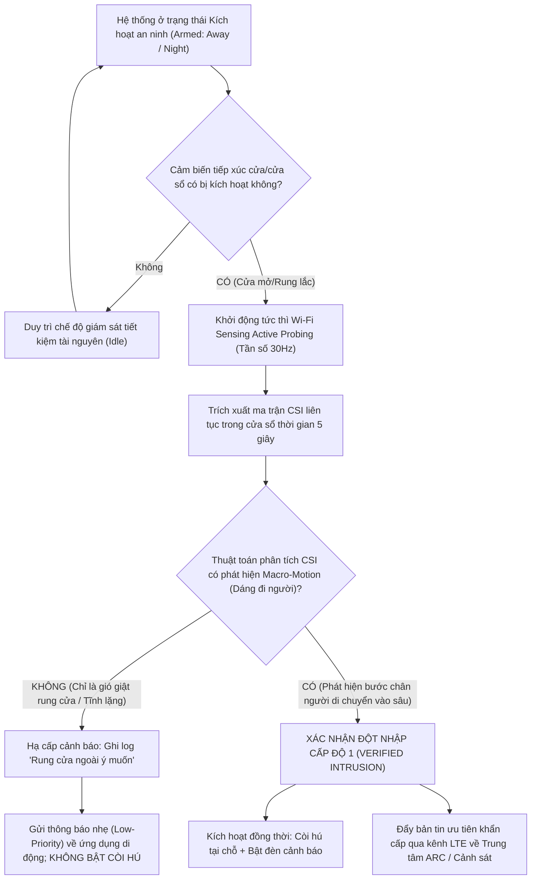

# BÁO CÁO PHÂN TÍCH KỸ THUẬT & KIẾN TRÚC HỆ THỐNG: CÔNG NGHỆ WI-FI SENSING THƯƠNG MẠI

> **Loại tài liệu**: Báo Cáo Phân Tích Kỹ Thuật & Kiến Trúc Hệ Thống (System Architecture & Technical Evaluation)  
> **Chuyên đề**: Khảo sát & Đánh giá Cơ chế Triển khai Thực tế của các Hệ thống Wi-Fi Sensing Thương mại  
> **Thời điểm cập nhật**: Tháng 11/2026  
> **Đối tượng tài liệu**: Kỹ sư Hệ thống Vô tuyến, Kiến trúc sư IoT, Kỹ sư Phát triển Sản phẩm Mạng

---

## MỤC LỤC TỔNG QUAN

1. [Tổng Quan Kỹ Thuật Hệ Thống Wi-Fi Sensing Thương Mại](#1-tổng-quan-kỹ-thuật-hệ-thống-wi-fi-sensing-thương-mại)
   - 1.1 Khái niệm & Bản chất hoạt động dưới góc độ hệ thống vô tuyến
   - 1.2 Hai ranh giới kỹ thuật cốt lõi định hình thiết kế hệ thống
2. [Kiến Trúc Phần Cứng & Cơ Chế Thu Thập Tín Hiệu Sóng](#2-kiến-trúc-phần-cứng--cơ-chế-thu-thập-tín-hiệu-sóng)
   - 2.1 Mô hình cặp liên kết vô tuyến (Tx - Rx Links) và các thành phần trong hệ thống
   - 2.2 So sánh tín hiệu: RSSI (công suất gộp) vs. CSI (ma trận trạng thái kênh chi tiết)
   - 2.3 Cơ chế phát gói tin thăm dò tích cực (Active Probing) và giải pháp khắc phục Client Deep Sleep
   - 2.4 Ranh giới năng lực xử lý: Chuyển động lớn (Macro-Motion) vs. Chuyển động nhỏ (Micro-Motion)
3. [Phân Tích Chi Tiết Kiến Trúc Hệ Thống Của Các Giải Pháp Thương Mại](#3-phân-tích-chi-tiết-kiến-trúc-hệ-thống-của-các-giải-pháp-thương-mại)
   - 3.1 Comcast Xfinity WiFi Motion: Mô hình Gateway AP phối hợp cụm thiết bị IoT cố định
   - 3.2 Verisure Beyond Sight: Mô hình Báo động trung tâm kết hợp Wi-Fi Vision bảo vệ điểm mù riêng tư
   - 3.3 ADT+ & Origin TruShield: Mô hình Phân loại dáng đi Edge-AI kết hợp chuỗi camera Google Nest
   - 3.4 WiZ SpaceSense (Signify): Mô hình Local Mesh tối thiểu 2 bóng đèn, xử lý độc lập tại biên không cần Gateway
   - 3.5 Plume Motion: Mô hình Mesh phân tán trên nền tảng OpenSync và nhận diện phân vùng không gian
   - 3.6 Linksys Aware (2019–2024): Phân tích nguyên nhân thất bại dưới góc độ hệ thống kỹ thuật
4. [Kiến Trúc Phối Hợp Đa Cảm Biến Trong Hệ Thống Thực Tế](#4-kiến-trúc-phối-hợp-đa-cảm-biến-trong-hệ-thống-thực-tế)
   - 4.1 Mô hình an ninh đa lớp: Camera ngoại vi + Cảm biến tiếp xúc cửa + Wi-Fi Sensing điểm mù
   - 4.2 Sơ đồ luồng ra quyết định (Decision Flow Logic) và cơ chế kích hoạt kép (Dual-Trigger)
5. [Đánh Giá Thực Nghiệm: Thách Thức Kỹ Thuật & Tỷ Lệ Lỗi Hiện Trường](#5-đánh-giá-thực-nghiệm-thách-thức-kỹ-thuật--tỷ-lệ-lỗi-hiện-trường)
   - 5.1 Bảng tổng hợp so sánh kiến trúc và thông số kỹ thuật các hệ thống thương mại
   - 5.2 Phân định mức độ sẵn sàng công nghệ (TRL) theo tính năng thực tế
   - 5.3 Thử nghiệm thực địa 2.4 triệu mẫu: Thách thức báo động giả từ thú cưng và quạt trần
6. [Tiến Trình Phát Triển Phần Cứng & Chuẩn Hóa Hạ Tầng](#6-tiến-trình-phát-triển-phần-cứng--chuẩn-hóa-hạ-tầng)
   - 6.1 Chuẩn IEEE 802.11bf: Chuẩn hóa khuôn dạng gói tin cảm biến và giao thức bắt tay
   - 6.2 Wi-Fi 7 và NPU trên Router: Băng thông 320 MHz, Multi-Link Operation và xử lý tại biên (Edge)
   - 6.3 Đồng bộ hóa cục bộ qua chuẩn Matter: Tự động hóa không chạm trong mạng nội bộ

---

## 1. TỔNG QUAN KỸ THUẬT HỆ THỐNG WI-FI SENSING THƯƠNG MẠI

### 1.1 Khái niệm & Bản chất hoạt động dưới góc độ hệ thống vô tuyến

**Wi-Fi Sensing** (Cảm biến nhận thức qua sóng vô tuyến Wi-Fi) trong môi trường thương mại là một hệ thống phần mềm nhúng, tận dụng chính các trạm phát sóng Wi-Fi (Access Point / Router Gateway) và các thiết bị thu nhận sẵn có trong nhà để phát hiện sự thay đổi của môi trường truyền sóng xung quanh. 

Về bản chất vật lý, tín hiệu sóng Wi-Fi tần số 2.4 GHz, 5 GHz hoặc 6 GHz khi lan truyền trong không gian kín của căn hộ không chỉ đi theo một đường thẳng trực tiếp (Line-of-Sight - LoS) từ bộ phát sang bộ thu. Sóng liên tục va đập, phản xạ, tán xạ và khúc xạ qua các bức tường, sàn nhà, trần nhà và các đồ vật nội thất, tạo nên một trường sóng giao thoa đa đường (Multipath Field) đan xen dày đặc.

```
                  ┌─────────────────────────────────────┐
                  │          TRẦN NHÀ & TƯỜNG           │
                  └──────────────┬───────────────┬──────┘
                   Tia phản xạ 1 │               │ Tia phản xạ 2
                                 ▼               ▼
┌──────────────────┐         ┌───────────────────────┐         ┌──────────────────┐
│  BỘ PHÁT (Tx)    ├────────►│   CƠ THỂ CON NGƯỜI    ├────────►│   BỘ THU (Rx)    │
│  (Router/Gateway)│ LoS     │ (Hấp thụ & Làm lệch   │         │ (Router/Node/    │
│                  │ Trực    │  pha trường sóng)     │         │  Bóng đèn IoT)   │
└──────────────────┘ tiếp    └───────────────────────┘         └────────┬─────────┘
                                                                        │
                                   Ma trận kênh CSI trích xuất tầng PHY │
                                                                        ▼
                                                       ┌────────────────┴─────────┐
                                                       │  BỘ XỬ LÝ BIÊN (EDGE AI) │
                                                       │  - Lọc trôi pha (CFO/SFO)│
                                                       │  - Trích xuất Doppler    │
                                                       │  - Phân loại chuyển động │
                                                       └──────────────────────────┘
```

Một hệ thống Wi-Fi Sensing thương mại hoàn chỉnh gồm 5 khối chức năng cốt lõi:
1. **Khối nguồn phát tín hiệu (Transmitter Node - Tx)**: Router hoặc thiết bị phụ trợ gửi các gói tin vô tuyến định kỳ qua không gian.
2. **Kênh truyền dẫn không gian (Propagation Medium)**: Toàn bộ thể tích không gian trong phòng nơi sóng đa đường lan truyền. Khi một người bước vào, cơ thể chứa hơn 70% nước sẽ hấp thụ một phần năng lượng vô tuyến và làm thay đổi góc pha cũng như thời gian trễ của các tia sóng phản xạ.
3. **Khối trích xuất thông tin kênh (CSI Extractor - Rx)**: Chipset Wi-Fi ở đầu thu trích xuất ma trận thông tin trạng thái kênh (Channel State Information - CSI) trên từng sóng mang con (subcarrier) tại tầng vật lý (PHY layer).
4. **Khối tiền xử lý và lọc nhiễu (Signal Processing Engine)**: Loại bỏ các sai số phần cứng như trôi tần số sóng mang (Carrier Frequency Offset - CFO), trôi tần số lấy mẫu (Sampling Frequency Offset - SFO), và bù trừ bước nhảy pha ngẫu nhiên.
5. **Khối nhận diện và ra quyết định (Inference & Coordination Engine)**: Mô hình thuật toán (ngưỡng động hoặc học máy nhẹ) phân tích biến thiên năng lượng và dịch chuyển Doppler để xác định trạng thái chuyển động, sau đó phối hợp cùng hệ sinh thái thiết bị để đưa ra hành động (bật đèn, báo động, hoặc gửi sự kiện).

---

### 1.2 Hai ranh giới kỹ thuật cốt lõi định hình thiết kế hệ thống

Trong thiết kế hệ thống thực tế, các kỹ sư và kiến trúc sư sản phẩm cần phân định rõ ràng hai ranh giới kỹ thuật định hình toàn bộ cấu trúc của các sản phẩm thương mại hiện nay:

#### Ranh giới 1: Phòng thí nghiệm lý tưởng đối lập hoàn toàn với Căn hộ thực tế
Nhiều nghiên cứu học thuật công bố độ chính xác nhận diện đạt từ 95% đến 99%. Tuy nhiên, các kết quả này gần như luôn được đo đạc trong các điều kiện lý tưởng hóa: phòng trống diện tích nhỏ, cự ly trực diện 2–3 mét không vật cản, chỉ một người duy nhất di chuyển theo kịch bản vạch sẵn, kênh sóng hoàn toàn sạch không bị can nhiễu, và thiết bị client được cắm nguồn liên tục phát gói tin 100 Hz.

Khi đưa ra căn hộ thực tế, môi trường vận hành lập tức đối mặt với hàng loạt thách thức:
- **Suy hao vật lý lớn**: Tường bê tông cốt thép dày 15–20 cm gây suy hao từ 20 đến 30 dB, tạo ra các vùng bóng râm vô tuyến (Fresnel shadows).
- **Can nhiễu đa mạng**: Căn hộ chung cư thường xuyên bị chồng lấn bởi 10–20 mạng Wi-Fi của các căn hộ lân cận trên cùng dải tần, làm sai lệch các thông số đo đạc pha của sóng.
- **Vật thể chuyển động ký sinh**: Quạt trần quay liên tục, rèm cửa đung đưa trước gió điều hòa, hoặc robot hút bụi tự hành tạo ra các biến thiên tuần hoàn dễ gây nhiễu thuật toán.
- **Cơ chế tiết kiệm pin của thiết bị đầu cuối**: Điện thoại di động khi tắt màn hình lập tức kích hoạt chế độ ngủ sâu (Deep Sleep), ngắt việc trao đổi gói tin định kỳ và làm gãy luồng dữ liệu sóng liên tục.

#### Ranh giới 2: Wi-Fi Sensing thuần túy là Lớp cảm biến hỗ trợ phụ trợ (Auxiliary Layer)
Do các rào cản vật lý nói trên, không có bất kỳ hệ sinh thái thương mại nào trên thế giới định vị Wi-Fi Sensing như một giải pháp an ninh độc lập thay thế camera. Giá trị thực tế đã được kiểm chứng của công nghệ này tập trung vào hai năng lực bổ trợ then chốt:
1. **Bảo vệ điểm mù camera tại các khu vực nhạy cảm**: Làm lớp cảnh giới phụ tại các không gian cấm lắp camera vì lý do quyền riêng tư (như phòng ngủ, phòng tắm, phòng thay đồ) nhằm xác nhận có kẻ xâm nhập bước vào sâu trong nhà.
2. **Phát hiện chuyển động lớn (Macro-Motion) khi nhà vắng**: Phát hiện bước chân người đi lại hoặc mở cửa lớn khi toàn bộ gia đình đã ra ngoài (chế độ Away), từ đó kích hoạt hệ thống báo động hoặc bật hệ thống chiếu sáng tự động.

*Lưu ý thiết kế hệ thống*: Tất cả các giải pháp thương mại thành công (Comcast, Verisure, ADT, WiZ) đều tích hợp Wi-Fi Sensing vào một chuỗi phối hợp nhiều cảm biến, tuyệt đối không trao quyền quyết định báo động duy nhất cho sóng Wi-Fi.

---

## 2. KIẾN TRÚC PHẦN CỨNG & CƠ CHẾ THU THẬP TÍN HIỆU SÓNG

### 2.1 Mô hình cặp liên kết vô tuyến (Tx - Rx Links) và các thành phần trong hệ thống

Một hệ thống Wi-Fi Sensing không thể hoạt động đơn lẻ với một ăng-ten độc lập mà vận hành dựa trên các **cặp liên kết vô tuyến (Radio Links)**. Trong mỗi cặp, một thiết bị đóng vai trò phát (Tx) và thiết bị kia đóng vai trò thu (Rx).

```
                      ┌────────────────────────┐
                      │ ROUTER GATEWAY (AP)    │
                      │ Đóng vai trò Bộ thu Rx │
                      └───────────┬────────────┘
                                  │
         ┌────────────────────────┼────────────────────────┐
         │ Link 1                 │ Link 2                 │ Link 3
         ▼                        ▼                        ▼
┌─────────────────┐      ┌─────────────────┐      ┌─────────────────┐
│ Smart TV        │      │ Loa thông minh  │      │ Ổ cắm / Đèn     │
│ (Node phát Tx1) │      │ (Node phát Tx2) │      │ (Node phát Tx3) │
│ [Cố định 220V]  │      │ [Cố định 220V]  │      │ [Cố định 220V]  │
└─────────────────┘      └─────────────────┘      └─────────────────┘
```

Các thành phần phần cứng điển hình trong một cấu hình triển khai gia đình:
- **Thiết bị tập trung (Central Gateway / Access Point)**: Thường là modem router chính của nhà mạng (như Comcast XB7/XB8, router Wi-Fi 6 của nhà mạng viễn thông) hoặc bộ điều khiển trung tâm (Alarm Hub). Thiết bị này sở hữu năng lực xử lý mạnh (SoC lõi kép hoặc lõi tứ, bộ nhớ RAM từ 512MB đến 1GB), đóng vai trò bộ thu (Rx) để trích xuất CSI và chạy thuật toán phân loại chuyển động.
- **Các thiết bị vệ tinh Mesh (Mesh Pods / Extenders)**: Đóng vai trò vừa là bộ thu vừa là bộ phát, tạo ra các đường truyền liên kết không dây phân tán (Backhaul Sensing Links) giữa các phòng.
- **Các thiết bị đầu cuối cố định (Fixed IoT Clients)**: Smart TV, loa thông minh (Amazon Echo, Google Nest Audio), ổ cắm thông minh, hoặc công tắc thông minh gắn tường. Đây là các đối tượng được cấp nguồn liên tục từ điện lưới 220V, vị trí đặt cố định trong không gian, đóng vai trò trạm phát tín hiệu phản hồi ổn định cho Gateway.

---

### 2.2 So sánh tín hiệu: RSSI (công suất gộp) vs. CSI (ma trận trạng thái kênh chi tiết)

Hai cấp độ dữ liệu sóng vô tuyến được ứng dụng trong nhận biết môi trường:

| Tiêu chí kỹ thuật | RSSI (Received Signal Strength Indicator) | CSI (Channel State Information) |
| :--- | :--- | :--- |
| **Bản chất đo đạc** | Giá trị vô hướng (scalar), biểu thị tổng công suất tín hiệu nhận được trên toàn bộ kênh tần số (đơn vị dBm). | Ma trận số phức (complex matrix), biểu thị biên độ (amplitude) và góc pha (phase) chi tiết trên từng sóng mang con (subcarrier) riêng biệt. |
| **Độ phân giải không gian** | Rất thấp: Chỉ là 1 giá trị duy nhất cho mỗi gói tin nhận được. Không phân biệt được các đường phản xạ khác nhau. | Rất cao: Cung cấp từ 52 (Wi-Fi 4 - 20MHz) đến gần 1000 điểm đo (Wi-Fi 7 - 320MHz) trên mỗi gói tin. Tách bạch rõ các thành phần đa đường. |
| **Độ nhạy chuyển động** | Kém: Khi người di chuyển, công suất tổng có thể bù trừ giữa các đường phản xạ, khiến RSSI gần như đứng yên hoặc biến thiên ngẫu nhiên. | Rất nhạy: Chỉ cần một bước chân lệch nhẹ, pha và biên độ của các sóng mang con tương ứng lập tức biến đổi rõ rệt. |
| **Năng lực phân loại đối tượng** | Không có: Không thể phân biệt được người đi lại với việc có người đóng cửa phòng hoặc nhiễu sóng ngẫu nhiên. | Có: Thuật toán có thể phân tích phổ Doppler trên từng sóng mang con để bóc tách nhịp bước chân người với đuôi của chó mèo hoặc quạt trần. |
| **Yêu cầu phần cứng & Firmware** | Mọi chip Wi-Fi tiêu chuẩn đều hỗ trợ đọc qua tập lệnh thông thường. | Đòi hỏi firmware của chip Wi-Fi mở cổng trích xuất bộ đệm PHY (như Qualcomm Ath11k, Broadcom BCM43xx, MaxLinear AnyWAN). |

*Lưu ý kỹ thuật*: Các giải pháp cảm biến chuyển động thế hệ đầu (giai đoạn 2017–2019) dựa thuần túy trên RSSI đều đã bị đào thải vì tỷ lệ báo động giả vượt quá mức chịu đựng của người dùng. Mọi hệ thống thương mại đáng tin cậy hiện nay đều bắt buộc phải xây dựng trên nền tảng dữ liệu CSI.

---

### 2.3 Cơ chế phát gói tin thăm dò tích cực (Active Probing) và giải pháp khắc phục Client Deep Sleep

#### Cơ chế phát gói tin thăm dò tích cực (Active Probing)
Một bài toán kỹ thuật lớn đặt ra: Nếu người dùng trong nhà đang ngủ hoặc không ai sử dụng mạng (không lướt web, không xem video), đường truyền Wi-Fi sẽ hoàn toàn tĩnh lặng. Nếu không có gói tin nào được truyền qua lại, đầu thu Rx sẽ không có dữ liệu để tính toán CSI.

Để giải quyết bài toán này, các hệ thống thương mại triển khai cơ chế **Active Probing**:
- Gateway định kỳ tạo ra các khung truyền thăm dò tích cực (chẳng hạn như gói tin rỗng không tải *Null Data Packet - NDP*, khung điều khiển *QoS Null Frames*, hoặc bản tin *ARP Ping* tầng mạng).
- Các gói tin này được gửi định kỳ với tần số kiểm tra cố định: từ **10 Hz đến 30 Hz** (10–30 gói/giây). Tần số này đủ dày để bắt trọn nhịp bước chân của người di chuyển (bước chân người có tần số vận động từ 1.5 Hz đến 3 Hz, theo định lý Nyquist cần tần số lấy mẫu tối thiểu từ 6 Hz trở lên), đồng thời không gây nghẽn băng thông mạng dữ liệu thông thường.

```
Router Gateway (Rx)                                         Thiết bị IoT Cố định (Tx)
        │                                                              │
        │── Khung QoS Null Frame (Tần số 20 Hz, chu kỳ 50ms) ─────────►│
        │◄─ Khung ACK / Phản hồi lớp PHY ──────────────────────────────│
        │                                                              │
[Trích xuất CSI từ Header PHY của gói ACK]                             │
[Đưa ma trận CSI vào bộ đệm tính toán]                                 │
        │                                                              │
        │── Khung QoS Null Frame tiếp theo ───────────────────────────►│
        │◄─ Khung ACK / Phản hồi lớp PHY ──────────────────────────────│
```

#### Giải pháp kỹ thuật vượt qua rào cản "Client Deep Sleep"
Trên lý thuyết, nhiều người kỳ vọng chiếc điện thoại smartphone trong túi người dùng có thể làm đối tác thu phát sóng. Tuy nhiên trong thực tế triển khai, điều này hoàn toàn bất khả thi:
- Hệ điều hành iOS (Apple) và Android có cơ chế quản lý năng lượng cực kỳ nghiêm ngặt. Khi màn hình tắt sau vài chục giây, điện thoại lập tức chuyển sang chế độ ngủ sâu (Deep Sleep / Doze Mode). Chip Wi-Fi trên điện thoại ngắt liên lạc định kỳ, chỉ thức dậy sau vài phút để nhận bản tin DTIM beacon, làm đứt gãy hoàn toàn chuỗi đo đạc CSI.
- Hơn nữa, điện thoại liên tục kích hoạt tính năng MAC Randomization (ngẫu nhiên hóa địa chỉ MAC) khi quét mạng, khiến router khó duy trì định danh cảm biến ổn định.

*Cách giải quyết trong kiến trúc thương mại*: Các hệ thống như Comcast Xfinity, Origin AI, hay Plume **hoàn toàn không dựa vào điện thoại di động để làm mốc cảm biến**. Thay vào đó, hệ thống tự động quét mạng nội bộ và lựa chọn các **thiết bị IoT cắm điện cố định (Mains-powered static clients)**:
- Smart TV, Apple TV, loa thông minh cắm ổ điện, ổ cắm thông minh, hoặc giữa các nút Mesh Pods với nhau.
- Các thiết bị này không bao giờ rơi vào Deep Sleep ngắt Wi-Fi, vị trí vật lý hoàn toàn cố định trong phòng, tạo nên các đường liên kết vô tuyến chuẩn mực có độ ổn định hình học cao.

---

### 2.4 Ranh giới năng lực xử lý: Chuyển động lớn (Macro-Motion) vs. Chuyển động nhỏ (Micro-Motion)

Các thuật toán xử lý tín hiệu CSI thương mại phân chia năng lượng biến thiên thành hai cấp độ vận động rõ rệt:

```
Năng lượng biến thiên CSI
      ▲
      │       ┌────────────────────────────────────────────────────────┐
 Cao  │       │ NHÓM CHUYỂN ĐỘNG LỚN (MACRO-MOTION)                    │
      │       │ - Người bước đi, chạy nhảy, mở tung cửa phòng          │
      │       │ - Tín hiệu vượt trội hoàn toàn sàn nhiễu (SNR cao)     │
      │       │ - ĐÃ THƯƠNG MẠI HÓA ỔN ĐỊNH VÀ BÁN ĐẠI TRÀ            │
      │       └────────────────────────────────────────────────────────┘
      │
      │ - - - - - Ngưỡng phân định độ tin cậy thương mại - - - - - - - -
      │
      │       ┌────────────────────────────────────────────────────────┐
      │       │ NHÓM CHUYỂN ĐỘNG NHỎ (MICRO-MOTION)                    │
      │       │ - Lồng ngực thở khi nằm ngủ, nhịp đập mạch máu         │
      │       │ - Ngón tay cử động nhẹ, người ngồi im đọc sách         │
      │       │ - Tín hiệu cực yếu, dễ bị chìm trong rung động nhà thờ │
 Thấp │       │ - CHƯA THỂ THƯƠNG MẠI HÓA TRÊN WI-FI GIA DỤNG TIÊU CHUẨN│
      │       └────────────────────────────────────────────────────────┘
      └────────────────────────────────────────────────────────────────► Thời gian
```

1. **Nhóm chuyển động lớn (Macro-Motion) — Đã làm chủ trong thương mại:**
   - *Hành vi*: Bước chân người lớn đi lại trong phòng, người chạy, vung tay, mở cửa phòng lớn.
   - *Đặc tính tín hiệu*: Cơ thể người (diện tích phản xạ sóng khoảng 0.5–1.0 $m^2$) cắt ngang các chùm tia Fresnel chính, tạo nên sự dịch chuyển pha đột ngột trên hàng loạt sóng mang con cùng lúc. Tỷ số tín hiệu trên nhiễu (SNR) của biến thiên này rất cao, dễ dàng nhận diện bằng các thuật toán phương sai biên độ kết hợp biến đổi sóng con (Wavelet Transform).
   - *Ứng dụng thực tế*: Modem Comcast phát hiện người lạ đi lại khi nhà vắng; bóng đèn WiZ SpaceSense bật sáng khi người bước vào phòng.

2. **Nhóm chuyển động nhỏ (Micro-Motion) — Thách thức lớn ngoài phòng lab:**
   - *Hành vi*: Lồng ngực phập phồng theo nhịp thở (độ dịch chuyển chỉ từ vài milimét đến 1 xentimét), rung động nhịp tim, cử động ngón tay lướt điện thoại, người nằm im ngủ trên giường.
   - *Đặc tính tín hiệu*: Biến thiên pha cực nhỏ (dưới vài độ pha). Tín hiệu này dễ dàng bị nhấn chìm bởi rung lắc của quạt trần, máy giặt đang vắt, xe tải chạy ngoài đường làm rung tường, hoặc người đi lại ở căn hộ tầng trên.
   - *Thực tế thị trường*: Nếu người dùng bước vào phòng bật đèn WiZ rồi ngồi yên đọc sách trên ghế sofa, bóng đèn vẫn sẽ tự động tắt sau vài phút vì thuật toán không bắt được chuyển động tĩnh. Các thiết bị y tế chuyên dụng theo dõi người già (như Aloe Care Health Smart Hub) hiện nay đều phải tích hợp chip **Radar sóng milimet (mmWave 60GHz)** với chùm sóng hẹp chuyên dụng chứ không thể dựa vào sóng Wi-Fi gia dụng thông thường.

---

## 3. PHÂN TÍCH CHI TIẾT KIẾN TRÚC HỆ THỐNG CỦA CÁC GIẢI PHÁP THƯƠNG MẠI

### 3.1 Comcast Xfinity WiFi Motion: Mô hình Gateway AP phối hợp cụm thiết bị IoT cố định

Hệ thống Xfinity WiFi Motion của Comcast là minh chứng điển hình cho mô hình khai thác trực tiếp trên router gia đình của nhà mạng viễn thông:

```
┌──────────────────────────────────────────────────────────────────────────┐
│                      KIẾN TRÚC COMCAST XFINITY                           │
│                                                                          │
│  [Outdoor / Sảnh]          [Phòng Khách]              [Khu Vực Phụ]     │
│  ┌────────────────┐        ┌──────────────────┐       ┌────────────────┐ │
│  │ Xfinity Video  │        │ Gateway XB7/XB8  │       │ xFi Pods       │ │
│  │ Doorbell       │◄──────►│ (Broadcom SoC/   │◄─────►│ (Nút Mesh      │ │
│  │ (Camera chuông)│        │  CSI Collector)  │       │  phòng ngủ)    │ │
│  └────────────────┘        └────────┬─────────┘       └────────────────┘ │
│                                     │                                    │
│                    Cặp liên kết     │ Thăm dò Active Probe               │
│                    vô tuyến 10-20Hz │ (QoS Null Frames)                  │
│                                     ▼                                    │
│                         ┌───────────────────────┐                        │
│                         │ Thiết bị IoT cố định  │                        │
│                         │ (Smart TV, Loa Echo,  │                        │
│                         │  Ổ cắm xFi)           │                        │
│                         └───────────────────────┘                        │
└──────────────────────────────────────────────────────────────────────────┘
```

- **Cấu trúc phần cứng**:
  - Trung tâm thu nhận: Router Gateway Comcast XB7, XB8 hoặc XB10 (sử dụng SoC mạng Broadcom BCM4908 / MaxLinear AnyWAN với chip Wi-Fi 6/6E).
  - Vệ tinh phản xạ: Các bộ mở rộng xFi Pods và các thiết bị gia dụng cắm điện cố định (Smart TV, loa Echo, loa Apple HomePod, thiết bị streaming Roku).
- **Cơ chế thu thập & Luồng dữ liệu**:
  - Khi người dùng kích hoạt trạng thái "Vắng nhà" (Away Mode) trên ứng dụng di động Xfinity, Gateway tự động chọn ra từ 3 đến 5 thiết bị Wi-Fi cố định có chỉ số liên kết sóng (Link Quality / RSSI) ổn định nhất trong nhà để thiết lập mạng lưới cảm biến.
  - Gateway định kỳ gửi các gói tin thăm dò Active Probe tới các thiết bị này ở tần số 10–20 Hz. Chip thu trên Gateway trích xuất dữ liệu CSI của các gói phản hồi và nạp vào bộ xử lý tín hiệu nhúng trong firmware.
- **Cơ chế phối hợp an ninh**:
  - Gateway phối hợp chặt chẽ với camera chuông cửa Xfinity Video Doorbell và các cảm biến cửa xFi Door Sensors. Nếu cảm biến cửa mở mà chuông cửa ngoài sảnh không nhận diện được người nhà, hệ thống lập tức theo dõi luồng CSI trên Gateway để phát hiện hướng di chuyển của đối tượng trong nhà.

---

### 3.2 Verisure Beyond Sight: Mô hình Báo động trung tâm kết hợp Wi-Fi Vision bảo vệ điểm mù riêng tư

Verisure (tập đoàn an ninh vận hành tại 18 quốc gia Châu Âu) xây dựng hệ thống an ninh đa tầng phối hợp công nghệ Wi-Fi Vision (hợp tác công nghệ cùng Origin AI):

```
                               ┌────────────────────────────────┐
                               │  TRUNG TÂM PHẢN ỨNG BÁO ĐỘNG   │
                               │  VERISURE ARC (24/7 CÓ NGƯỜI)  │
                               └────────────────┬───────────────┘
                                                ▲ Kênh 4G khẩn cấp
                                                │ (Báo động cấp 1)
┌───────────────────────────────────────────────┴──────────────────────────┐
│                   HỆ THỐNG AN NINH TẠI CĂN HỘ GIA ĐÌNH                   │
│                                                                          │
│  [Vòng 1: Cửa Chính & Sân]             [Vòng 3: Phòng Ngủ / Điểm Mù]     │
│  ┌────────────────────────┐            ┌───────────────────────────────┐ │
│  │ Camera Arlo Pro        │            │ Cụm sóng Wi-Fi Vision         │ │
│  │ Cảm biến tiếp xúc cửa  │            │ (Quét ma trận sóng phòng ngủ) │ │
│  └───────────┬────────────┘            └───────────────▲───────────────┘ │
│              │ Cạy cửa                                 │ Kích hoạt quét  │
│              ▼ lúc nửa đêm                             │ tức thì (5s)    │
│  ┌─────────────────────────────────────────────────────┴───────────────┐ │
│  │ BỘ ĐIỀU KHIỂN TRUNG TÂM VERISURE VBOX (Alarm Hub tích hợp Wi-Fi+LTE)│ │
│  │ Logic kích hoạt kép: Cửa mở AND Wi-Fi phát hiện người -> BÁO ĐỘNG!  │ │
│  └─────────────────────────────────────────────────────────────────────┘ │
└──────────────────────────────────────────────────────────────────────────┘
```

- **Cấu trúc phần cứng**:
  - Bộ điều khiển trung tâm (Central Alarm Hub - VBox): Tích hợp kết nối Wi-Fi, sóng Sub-GHz chuyên dụng cho cảm biến an ninh và module SIM 4G LTE kết nối trực tiếp về trung tâm phản ứng báo động Verisure (Alarm Receiving Centre - ARC).
  - Hệ thống thị giác ngoại vi: Camera an ninh ngoài trời Arlo Pro lắp tại cổng ra vào và phòng khách.
  - Hệ thống sóng điểm mù: Các cảm biến an ninh thông minh có kết nối Wi-Fi đặt tại phòng ngủ và phòng tắm.
- **Cơ chế vận hành của Wi-Fi Vision**:
  - Tại phòng ngủ và phòng thay đồ của gia chủ, Verisure cam kết không lắp bất kỳ camera ghi hình nào để bảo vệ quyền riêng tư tuyệt đối cho khách hàng.
  - Thay vào đó, Hub trung tâm và các node phụ thiết lập trường sóng Wi-Fi phủ kín không gian phòng ngủ.
- **Cơ chế kích hoạt kép (Dual-Factor Verification)**:
  - Khi cảm biến từ gắn cửa sổ phòng ngủ báo rung hoặc mở lúc nửa đêm, hệ thống chưa vội bấm còi báo động để tránh gây hoảng loạn vì báo động giả do gió rung.
  - Hub lập tức kích hoạt tính năng Wi-Fi Vision quét trường sóng phòng ngủ với tần suất cao trong vòng 5 giây. Nếu dữ liệu CSI ghi nhận biến dạng khớp với thể tích và bước chân của cơ thể người, hệ thống lập tức nâng cấp cảnh báo lên mức "Xâm nhập đã xác thực" (Verified Intrusion), truyền tín hiệu qua mạng 4G về trung tâm ARC để nhân viên an ninh gọi cảnh sát khẩn cấp.

---

### 3.3 ADT+ & Origin TruShield: Mô hình Phân loại dáng đi Edge-AI kết hợp chuỗi camera Google Nest

Sau thương vụ mua lại Origin AI vào tháng 02/2026, ADT (tập đoàn an ninh lớn nhất nước Mỹ) đã tích hợp sâu nền tảng TruShield vào hệ sinh thái an ninh ADT+:

- **Cấu trúc phần cứng**:
  - Bộ điều khiển ADT Smart Home Base kết nối với hệ thống camera thông minh Google Nest Cams (ngoài sân, sảnh chính, hành lang chung).
  - Tầng sóng vô tuyến: Tận dụng các thiết bị Wi-Fi gia đình hiện hữu (router tương thích và các thiết bị IoT) mà không yêu cầu khách hàng mua thêm phần cứng cảm biến chuyển động chuyên biệt.
- **Cơ chế phân loại dáng đi (Gait & Mass Classification)**:
  - Điểm khác biệt kỹ thuật lớn nhất của nền tảng Origin TruShield trên ADT+ là việc ứng dụng mô hình học máy (Machine Learning - SVM / Random Forest tối ưu hóa cho vi điều khiển) để phân tích các sóng mang con.
  - Mô hình bóc tách đặc trưng vận động: Khi có chuyển động, thuật toán phân tích năng lượng Doppler và độ trễ pha để ước tính thể tích khối di chuyển và nhịp bước chân. Nhờ đó, hệ thống có khả năng lọc bỏ chuyển động của chó mèo lớn (trọng lượng từ 10 kg đến 20 kg) và chỉ phát cảnh báo khi phát hiện dáng đi đặc trưng của người lớn.
- **Phối hợp hệ thống**:
  - Dữ liệu sóng được xử lý sơ bộ ngay tại thiết bị biên (Edge Hub). Khi phát hiện chuyển động con người tại các góc khuất, hệ thống ADT+ lập tức kích hoạt các camera Google Nest gần đó quay quét về hướng hành lang để sẵn sàng ghi hình nếu kẻ xâm nhập di chuyển ra khu vực chung.

---

### 3.4 WiZ SpaceSense (Signify): Mô hình Local Mesh tối thiểu 2 bóng đèn, xử lý độc lập tại biên không cần Gateway

Hệ thống SpaceSense của thương hiệu đèn thông minh WiZ (thuộc Tập đoàn Signify / Philips) là mô hình triển khai độc đáo, tối giản và tự vận hành hoàn toàn cục bộ:

```
┌────────────────────────────────────────────────────────────────────────┐
│                        MÔ HÌNH WIZ SPACESENSE                          │
│                                                                        │
│        BÓNG ĐÈN 1 (Tx)                           BÓNG ĐÈN 2 (Rx)       │
│        ┌──────────────┐                          ┌──────────────┐      │
│        │ Chip SoC     │                          │ Chip SoC     │      │
│        │ Wi-Fi nhúng  │                          │ Wi-Fi nhúng  │      │
│        └──────┬───────┘                          └──────▲───────┘      │
│               │                                         │              │
│               │     Trao đổi gói tin liên tục (Local)   │              │
│               └─────────────────────────────────────────┘              │
│                                    │                                   │
│                        Cắt ngang luồng sóng khi                        │
│                        có người bước vào phòng                         │
│                                    ▼                                   │
│                           ┌─────────────────┐                          │
│                           │ BƯỚC CHÂN NGƯỜI │                          │
│                           └─────────────────┘                          │
│                                    │                                   │
│           Vi điều khiển trên bóng Rx tính toán biến thiên sóng         │
│           -> TỰ KÍCH HOẠT RƠ-LE BẬT ĐÈN TRONG < 200 MILI-GIÂY          │
│           (KHÔNG CẦN ROUTER, KHÔNG CẦN HUB, KHÔNG QUA CLOUD)           │
└────────────────────────────────────────────────────────────────────────┘
```

- **Cấu trúc phần cứng**:
  - Không cần Gateway, không cần Hub trung tâm, không cần kết nối tới router để kích hoạt cảm biến.
  - Yêu cầu phần cứng tối thiểu: **Ít nhất 2 bóng đèn WiZ lắp trong cùng một phòng**, cách nhau từ 2 mét đến 6 mét.
- **Cơ chế liên kết và đo đạc**:
  - Trong một phòng, 2 bóng đèn tự động thiết lập một cặp liên kết vô tuyến cục bộ qua cơ chế phát quảng bá nội bộ (Local Wi-Fi Mesh Broadcast). Một bóng đóng vai trò phát xung tín hiệu (Tx), bóng còn lại đóng vai trò thu nhận (Rx).
  - Tín hiệu được trao đổi liên tục giữa 2 bóng đèn mà không đi qua router Wi-Fi gia đình và hoàn toàn không gửi dữ liệu ra ngoài Internet.
- **Xử lý 100% tại biên (Local Edge Processing)**:
  - Vi điều khiển trên bóng đèn thu (Rx) tự phân tích độ xáo trộn của trường sóng nhận được.
  - Khi có người bước vào giữa hai bóng đèn, thuật toán trên chip nhận biết độ lệch sóng và lập tức kích hoạt mạch điều khiển LED bật sáng trong thời gian **dưới 200 mili-giây**, đem lại trải nghiệm phản hồi tức thì tương đương cảm biến hồng ngoại PIR gắn tường.
  - Khi người ra khỏi phòng và không còn bước chân di chuyển, bộ đếm thời gian (timeout từ 3 đến 10 phút tùy người dùng thiết lập) sẽ kích hoạt lệnh tắt đèn tự động.

---

### 3.5 Plume Motion: Mô hình Mesh phân tán trên nền tảng OpenSync và nhận diện phân vùng không gian

Plume cung cấp nền tảng phần mềm dựa trên kiến trúc nguồn mở OpenSync, được triển khai trên hơn 100 nhà mạng băng rộng toàn cầu:

- **Cấu trúc phần cứng**:
  - Hệ thống mạng Mesh gồm từ 2 đến 4 nút Plume SuperPod cắm trực tiếp vào ổ cắm tường tại các phòng khác nhau (phòng khách, phòng ngủ, phòng làm việc).
- **Cơ chế đo lường liên kết Mesh (Backhaul Link Sensing)**:
  - Thay vì chỉ đo giữa 1 router và các thiết bị IoT, Plume đo lường đồng thời ma trận CSI trên toàn bộ các đường truyền kết nối chéo giữa các nút SuperPod (Mesh Backhaul Links).
  - Do các nút SuperPod giao tiếp trên cả hai dải tần 2.4 GHz và 5 GHz với công suất cao và ăng-ten đa hướng, lưới sóng của Plume bao phủ toàn bộ không gian căn nhà đa tầng.
- **Năng lực phân vùng không gian (Spatial Multi-Zone Sensing)**:
  - Nhờ có nhiều cặp liên kết không gian chéo nhau, thuật toán của Plume có thể định vị tương đối vùng chuyển động: Khi chỉ có đường truyền giữa SuperPod phòng khách và SuperPod hành lang bị xáo trộn, hệ thống xác định chuyển động đang diễn ra tại khu vực sinh hoạt chung; nếu đường truyền tới SuperPod phòng ngủ biến động lúc 2 giờ sáng, hệ thống kích hoạt cảnh báo đột nhập riêng biệt cho khu vực phòng ngủ.

---

### 3.6 Linksys Aware (2019–2024): Phân tích nguyên nhân thất bại dưới góc độ hệ thống kỹ thuật

Ra mắt vào cuối năm 2019 trên dòng router Mesh Linksys Velop, Linksys Aware là sản phẩm Wi-Fi Sensing tiêu dùng đầu tiên trên thế giới nhưng đã chính thức bị **đóng cửa và khai tử hoàn toàn vào năm 2024**. 

Phân tích các nguyên nhân kỹ thuật cốt lõi dẫn đến thất bại của hệ thống này:
1. **Kiến trúc thuật toán thời kỳ đầu thiếu bộ lọc nhiễu**: Hệ thống sử dụng phiên bản thuật toán đời đầu chưa có mô hình phân loại dáng đi hiệu quả. Khi thú cưng (chó, mèo) chạy qua phòng hoặc quạt máy quay, hệ thống liên tục gửi thông báo cảnh báo đẩy (Push Notification) lên điện thoại người dùng, gây ra hiện tượng mỏi mệt vì cảnh báo giả (Notification Fatigue).
2. **Độ trễ do phụ thuộc vào xử lý đám mây (Cloud Dependency)**: Linksys Aware gửi các đặc trưng biến động sóng lên máy chủ đám mây để phân tích rồi mới trả kết quả về điện thoại. Khi mạng Internet chập chờn hoặc máy chủ quá tải, cảnh báo bị trễ từ vài giây đến nửa phút, không đáp ứng được yêu cầu phản ứng tức thì của một hệ thống an ninh.
3. **Mô hình triển khai cô lập (Silo System)**: Linksys Aware hoạt động như một tính năng độc lập trên router, không thể kết nối hay kích hoạt camera an ninh sẵn có trong nhà, không có còi hú tại chỗ, và không có dịch vụ xác thực chuyên nghiệp. Người dùng chỉ nhận được một dòng thông báo chữ thô sơ "Có chuyển động", không thể biết chính xác chuyện gì đang diễn ra, dẫn đến việc người dùng tắt tính năng sau thời gian ngắn thử nghiệm.

---

## 4. KIẾN TRÚC PHỐI HỢP ĐA CẢM BIẾN TRONG HỆ THỐNG THỰC TẾ

### 4.1 Mô hình an ninh đa lớp: Camera ngoại vi + Cảm biến tiếp xúc cửa + Wi-Fi Sensing điểm mù

Trong thực tế triển khai, Wi-Fi Sensing không bao giờ hoạt động đơn độc mà đóng vai trò mắt xích liên kết giữa các công nghệ cảm biến khác nhau trong mô hình **Kiến trúc an ninh 3 vòng (3-Ring Security Architecture)**:

```
┌────────────────────────────────────────────────────────────────────────┐
│ VÒNG 1: NGOẠI VI & LỐI VÀO (Perimeter & Access Points)                 │
│ Thiết bị: Camera ngoài trời, Chuông cửa có hình (Arlo, Google Nest,    │
│           Xfinity Video Doorbell).                                     │
│ Năng lực: Ghi hình khuôn mặt, nhận diện biển số, phát hiện tiếp cận    │
│           ngoài sân bằng thuật toán thị giác máy tính (Computer Vision)│
└───────────────────────────────────┬────────────────────────────────────┘
                                    │ Kẻ đột nhập vượt rào, cạy cửa
┌───────────────────────────────────▼────────────────────────────────────┐
│ VÒNG 2: TIẾP GIÁP CỬA RA VÀO (Boundary Verification)                  │
│ Thiết bị: Cảm biến tiếp xúc từ tính (Door/Window Magnetic Contacts)    │
│ Năng lực: Bắt biến cố mở cửa hoặc phá khóa tức thời (độ trễ < 10ms)    │
└───────────────────────────────────┬────────────────────────────────────┘
                                    │ Cửa mở: Cần xác minh đột nhập thật
┌───────────────────────────────────▼────────────────────────────────────┐
│ VÒNG 3: KHÔNG GIAN RIÊNG TƯ & ĐIỂM MÙ CAMERA (Private Interior / Blinds)│
│ Thiết bị: LƯỚI SÓNG WI-FI SENSING (Tích hợp trên Router/IoT)           │
│ Vị trí:   Phòng ngủ chính, phòng trẻ em, phòng tắm, hành lang khuất    │
│ Năng lực: QUÉT KHÔNG GIAN KHÔNG CẦN HÌNH ẢNH:                          │
│           - Có vật thể mang thể tích người di chuyển vào sâu trong nhà?│
│           - Xác thực đột nhập vòng hai trước khi kích hoạt còi hú/     │
│             gọi cảnh sát. Bảo vệ quyền riêng tư tuyệt đối cho gia chủ. │
└────────────────────────────────────────────────────────────────────────┘
```

Mỗi lớp công nghệ trong kiến trúc bù trừ hoàn hảo cho điểm yếu của lớp khác:
- **Camera giám sát**: Cung cấp bằng chứng hình ảnh rõ ràng nhất, nhưng bị giới hạn nghiêm ngặt bởi góc nhìn ống kính và **hoàn toàn bị cấm lắp đặt trong phòng ngủ, nhà tắm** vì quyền riêng tư cá nhân.
- **Cảm biến tiếp xúc từ (Door Contacts)**: Bắt sự kiện mở cửa rất nhanh, nhưng rất dễ bị kích hoạt giả do gió bão giật mạnh làm rung khung cửa hoặc người dùng vô tình đóng cửa chưa khít.
- **Wi-Fi Sensing**: Đóng vai trò lớp kiểm chứng vô hình lấp đầy khoảng trống giữa hai lớp trên. Khi cảm biến cửa báo động lúc nửa đêm, sóng Wi-Fi kiểm tra xem có người đang bước đi trong phòng ngủ hay không mà không cần ghi lại bất kỳ hình ảnh nhạy cảm nào.

---

### 4.2 Sơ đồ luồng ra quyết định (Decision Flow Logic) và cơ chế kích hoạt kép (Dual-Trigger)

Để đạt được độ tin cậy cấp an ninh công nghiệp và ngăn ngừa tối đa các vụ phạt tiền do báo động giả, các hệ thống an ninh tích hợp áp dụng cơ chế kích hoạt kép (Dual-Factor Alarm Logic):



Quy trình xử lý logic gồm 4 bước nối tiếp:
1. **Bước 1 - Giám sát nhàn rỗi (Low-Power Monitoring)**: Khi nhà ở chế độ "Vắng mặt" (Away) hoặc "Ban đêm" (Night), hệ thống Wi-Fi Sensing chỉ chạy ở tần số thăm dò nền rất thấp (1–2 Hz) để tiết kiệm tài nguyên tính toán của router.
2. **Bước 2 - Đánh thức theo sự kiện (Event Wake-up)**: Ngay khi một cảm biến tiếp xúc cửa báo trạng thái hở mạch, bộ điều khiển trung tâm gửi lệnh nội bộ đánh thức module Wi-Fi Sensing, nâng tần suất thăm dò Active Probing lên cực đại (30 Hz).
3. **Bước 3 - Cửa sổ thẩm định 5 giây (5-Second Evaluation Window)**: Module Wi-Fi Sensing thu thập và phân tích dữ liệu CSI trong vòng 5 giây ngay sau khi cửa mở. Thuật toán kiểm tra sự xuất hiện của các dải tần số Doppler tương ứng với bước chân người lớn di chuyển.
4. **Bước 4 - Phân luồng quyết định**:
   - Nếu trường sóng hoàn toàn tĩnh lặng: Hệ thống kết luận sự cố mở cửa là do gió hoặc lỗi cảm biến. Báo động khẩn cấp được hủy bỏ, chỉ có một thông báo cảnh báo nhẹ được gửi về ứng dụng của người dùng.
   - Nếu trường sóng ghi nhận chuyển động người: Hệ thống xác thực đây là vụ xâm nhập thực sự, lập tức kích hoạt còi báo động toàn nhà và truyền dữ liệu khẩn cấp về trung tâm giám sát an ninh.

---

## 5. ĐÁNH GIÁ THỰC NGHIỆM: THÁCH THỨC KỸ THUẬT & TỶ LỆ LỖI HIỆN TRƯỜNG

### 5.1 Bảng tổng hợp so sánh kiến trúc và thông số kỹ thuật các hệ thống thương mại

| Nền tảng / Sản phẩm | Đơn vị phát triển | Cấu trúc phần cứng triển khai | Giao thức & Dữ liệu sóng | Vị trí xử lý tính toán | Khả năng phân loại người vs. vật | Vai trò kỹ thuật trong hệ thống |
| :--- | :--- | :--- | :--- | :--- | :--- | :--- |
| **Xfinity WiFi Motion** | Comcast | Gateway XB7/XB8 + xFi Pods + IoT Clients | CSI trên Wi-Fi 6 (Qualcomm/Broadcom) | Firmware Gateway (Edge) | Lọc được thú cưng nhỏ (<10 kg) | Phát hiện chuyển động lớn khi kích hoạt chế độ Away |
| **Beyond Sight** | Verisure / Origin AI | VBox Alarm Hub + Cảm biến Sub-GHz + Camera Arlo | CSI trích xuất tầng PHY | Hub trung tâm (Edge) | Nhận diện khối thể tích người | Lớp xác minh đột nhập vòng hai tại điểm mù camera phòng ngủ |
| **TruShield Platform** | ADT / Origin AI | ADT Smart Base + Google Nest Cams + Wi-Fi Hub | CSI ma trận đa đường 5 GHz | Cục bộ kết hợp Cloud | Có (Học máy phân loại dáng đi người vs. vật nuôi) | Lớp cảnh giới vô hình lấp điểm mù cho chuỗi camera |
| **SpaceSense** | Signify (WiZ) | Tối thiểu 2 bóng đèn WiZ trong 1 phòng | Bản tin Wi-Fi Mesh Broadcast nội bộ | Vi điều khiển bóng đèn (100% On-Device) | Không phân biệt (Mọi chuyển động lớn đều kích hoạt) | Tự động kích hoạt mạch đóng ngắt chiếu sáng (<200ms) |
| **Plume Motion** | Plume Design | Cụm nút SuperPod Mesh cắm tường | CSI trên đường truyền Backhaul đa điểm | Phân tán tại Pod và Cloud | Cơ bản (Lọc rung động môi trường) | Giám sát mức độ hoạt động và phân vùng chuyển động |
| **Linksys Aware** *(Đã dừng 2024)* | Linksys / Cognitive | Router Mesh Velop | CSI đời đầu | Cloud Server (Độ trễ cao) | Kém (Thường xuyên báo sai với vật nuôi) | Cảnh báo chuyển động thô độc lập qua ứng dụng di động |

---

### 5.2 Phân định mức độ sẵn sàng công nghệ (TRL) theo tính năng thực tế

Để đánh giá chính xác tính khả thi kỹ thuật khi phát triển thiết bị, các tính năng Wi-Fi Sensing được phân nhóm theo thang đo mức độ sẵn sàng công nghệ thực tế (Technology Readiness Level - TRL):

- **Nhóm 1: Mức TRL 9 &mdash; Đã triển khai thương mại hàng loạt, vận hành ổn định:**
  - Phát hiện bước chân người lớn đi lại trong nhà vắng (Comcast, Plume, Verisure).
  - Tự động bật/tắt thiết bị chiếu sáng theo bước chân người bước vào phòng (WiZ SpaceSense).
  - Nhận biết có người mở/đóng cửa thông qua biến đổi trường sóng đa đường mạnh.
- **Nhóm 2: Mức TRL 6–7 &mdash; Thương mại hóa có điều kiện, chỉ làm lớp hỗ trợ phụ trợ:**
  - Xác thực chuyển động vòng hai hỗ trợ điểm mù camera (Verisure Beyond Sight).
  - Phân loại bước chân người với chó mèo lớn trên 15 kg (Origin TruShield).
  - Nhận diện phân vùng không gian giữa các phòng (Multi-zone sensing trong mạng Mesh).
- **Nhóm 3: Mức TRL 3–4 &mdash; Vẫn dừng lại ở mức bài báo khoa học hoặc bản thử nghiệm phòng Lab:**
  - Theo dõi nhịp thở tĩnh và nhịp tim người ngủ xuyên tường qua router Wi-Fi gia dụng thông thường (tỷ lệ lỗi rất cao khi có quạt gió hoặc người nằm im).
  - Phát hiện chính xác người già té ngã trên thiết bị Wi-Fi gia đình (rủi ro trách nhiệm pháp lý cao; các thiết bị an toàn y tế hiện bắt buộc dùng Radar mmWave chuyên dụng).
  - Định vị tọa độ chính xác từng xentimét trong nhà.

---

### 5.3 Thử nghiệm thực địa 2.4 triệu mẫu: Thách thức báo động giả từ thú cưng và quạt trần

Minh chứng kỹ thuật rõ ràng nhất cho thấy sự khác biệt giữa phòng lab và môi trường thực tế đến từ số liệu thử nghiệm thực địa do nhóm nghiên cứu của **Origin Research** thực hiện:

- **Quy mô thử nghiệm**: Thu thập và phân tích **2.4 triệu mẫu dữ liệu CSI liên tục trong 84 ngày tại 7 căn hộ thực tế** có môi trường sinh hoạt điển hình: 5 con chó, 4 con mèo, hệ thống quạt trần hoạt động thường xuyên và robot hút bụi tự hành.
- **Kết quả đo lường độ chính xác**:
  - Khi sử dụng thuật toán phát hiện chuyển động dựa trên ngưỡng biến thiên năng lượng CSI thông thường: **Tỷ lệ báo động giả (False Alarm Rate) lên tới 63.1%**. Nghĩa là trong 10 lần hệ thống ghi nhận chuyển động, có hơn 6 lần nguyên nhân là do chó mèo chạy giỡn hoặc quạt trần quay.
  - Khi áp dụng mô hình máy học phân loại dáng đi (Gait Classifier) của Origin: Tỷ lệ báo động giả giảm xuống còn **8.4%**.

*Hàm ý kỹ thuật đối với kiến trúc hệ thống*: Con số 8.4% là một bước tiến vượt bậc của thuật toán học máy. Tuy nhiên, dưới góc độ hệ thống an ninh chuyên nghiệp, **tỷ lệ lỗi 8.4% vẫn là quá cao nếu để hệ thống tự động gọi điện cho cảnh sát hoặc kích hoạt còi hú lúc nửa đêm**. Đó chính là nguyên nhân giải thích vì sao trong thiết kế hệ thống thực tế của Verisure và ADT, sóng Wi-Fi không bao giờ được cấp quyền ra quyết định độc lập mà bắt buộc phải kết hợp cùng cảm biến tiếp xúc cửa và camera ở lớp ngoài cùng.

---

## 6. TIẾN TRÌNH PHÁT TRIỂN PHẦN CỨNG & CHUẨN HÓA HẠ TẦNG

### 6.1 Chuẩn IEEE 802.11bf: Chuẩn hóa khuôn dạng gói tin cảm biến và giao thức bắt tay

Một trong những rào cản lớn nhất của thị trường Wi-Fi Sensing trước đây là tính khép kín của các nhà sản xuất chip bán dẫn: Router dùng chip Broadcom không thể bắt tay cảm biến với bóng đèn dùng chip Realtek hay MediaTek vì mỗi bên đóng kín cấu trúc khuôn dạng dữ liệu CSI của mình.

Chuẩn **IEEE 802.11bf (WLAN Sensing)** chính thức được hoàn thiện mang lại các bước ngoặt kỹ thuật:
- **Định nghĩa khuôn dạng gói tin cảm biến chuẩn hóa (SENS PPDU)**: Quy định cấu trúc khung truyền tín hiệu dành riêng cho mục đích cảm biến, cho phép các thiết bị trích xuất thông tin trạng thái kênh mà không cần giải mã toàn bộ khối dữ liệu payload.
- **Chuẩn hóa giao thức bắt tay giữa các vai trò**:
  - *Sensing Initiator*: Thiết bị khởi xướng phiên đo đạc (thường là Router Gateway).
  - *Sensing Responder*: Thiết bị phản hồi tín hiệu đo đạc (các thiết bị IoT trong nhà).
- **Phá vỡ thế độc quyền chipset (Anti-Vendor Lock-in)**: Cho phép một router sử dụng chip Qualcomm có thể bắt cặp đo đạc CSI chuẩn xác với một bóng đèn thông minh dùng vi điều khiển ESP32 hoặc chip vô tuyến của bất kỳ bên thứ ba nào.

---

### 6.2 Wi-Fi 7 và NPU trên Router: Băng thông 320 MHz, Multi-Link Operation và xử lý tại biên (Edge)

Thế hệ công nghệ **Wi-Fi 7 (802.11be)** cùng sự phát triển của các bộ vi xử lý mạng thế hệ mới mang lại hai cải tiến đột phá cho kiến trúc hệ thống Wi-Fi Sensing:

1. **Băng thông kênh cực đại 320 MHz và độ nét đa đường**:
   - Độ phân giải không gian của sóng vô tuyến tỷ lệ thuận với độ rộng băng thông. Việc nâng băng thông từ 80 MHz (Wi-Fi 6) lên 320 MHz (Wi-Fi 7) giúp số lượng sóng mang con (subcarriers) tăng vọt, cho phép hệ thống tách bạch các tia phản xạ có độ chênh lệch thời gian trễ dưới 3 nano-giây. Nhờ đó, router có thể phân biệt chính xác chuyển động trong phòng khách với bước chân của người đi lại ngoài hành lang chung cư.
2. **Cơ chế hoạt động đa liên kết (Multi-Link Operation - MLO)**:
   - Wi-Fi 7 cho phép thiết bị truyền và nhận đồng thời trên nhiều băng tần (2.4 GHz, 5 GHz và 6 GHz). Hệ thống có thể dành riêng một băng tần phụ (chẳng hạn như dải 5 GHz rảnh) để gửi các gói tin thăm dò cảm biến Active Probing liên tục mà hoàn toàn không làm gián đoạn hay giảm tốc độ truyền tải dữ liệu của các luồng xem phim 4K hay chơi game trên dải tần 6 GHz.
3. **Bộ xử lý thần kinh NPU tích hợp trên chip Router (Edge AI)**:
   - Các dòng vi xử lý router thế hệ mới (như Qualcomm Networking Pro Series hay Broadcom BCM4916) tích hợp trực tiếp nhân xử lý AI chuyên dụng (NPU). Mô hình mạng nơ-ron phân loại chuyển động được thực thi trực tiếp trên router trong thời gian vài mili-giây. Toàn bộ dữ liệu sóng thô được xử lý cục bộ tại thiết bị biên và bị xóa ngay lập tức, **tuyệt đối không gửi dữ liệu hoạt động trong nhà lên đám mây**, giải quyết triệt để bài toán bảo mật và quyền riêng tư cá nhân.

---

### 6.3 Đồng bộ hóa cục bộ qua chuẩn Matter: Tự động hóa không chạm trong mạng nội bộ

Sự kết hợp giữa công nghệ Wi-Fi Sensing và chuẩn kết nối nhà thông minh **Matter** đang định hình kiến trúc tự động hóa không chạm (Zero-Touch Automation) trong mạng nội bộ gia đình:

```
┌────────────────────────────────────────────────────────────────────────┐
│                      MẠNG NỘI BỘ GIA ĐÌNH (LAN)                        │
│                                                                        │
│ ┌──────────────────────────┐             ┌───────────────────────────┐ │
│ │ ROUTER GATEWAY           │  Matter IP  │ THIẾT BỊ ĐIỀU HÒA / RÈM   │ │
│ │ - Module Wi-Fi Sensing   ├────────────►│ (Bật chế độ tiết kiệm     │ │
│ │ - Module Matter Bridge   │  Broadcast  │  khi không có người)      │ │
│ └────────────┬─────────────┘             └───────────────────────────┘ │
│              │                                                         │
│              │ Bản tin sự kiện cục bộ:                                 │
│              │ "Presence Detected: Living Room"                        │
│              ▼                                                         │
│ ┌──────────────────────────┐                                           │
│ │ HỆ THỐNG CHIẾU SÁNG      │                                           │
│ │ (Tự động bật sáng đèn khi│                                           │
│ │  có bước chân ban đêm)   │                                           │
│ └──────────────────────────┘                                           │
│                                                                        │
│ [HOẠT ĐỘNG HOÀN TOÀN CỤC BỘ QUA GIAO THỨC MATTER - KHÔNG PHỤ THUỘC INTERNET] │
└────────────────────────────────────────────────────────────────────────┘
```

- **Giao thức điều khiển thống nhất qua mạng IP nội bộ**: Chuẩn Matter hoạt động trên nền giao thức IPv6 thông qua Wi-Fi và Thread. Khi router Wi-Fi Sensing phát hiện có người bước vào phòng khách, nó phát trực tiếp bản tin sự kiện Matter tiêu chuẩn (`OccupancySensing Cluster`) tới các bóng đèn và điều hòa trong cùng mạng LAN.
- **Tự động hóa hoàn toàn không phụ thuộc Internet**: Ngay cả khi đường truyền Internet cáp quang bên ngoài bị đứt, chuỗi liên kết tự động hóa giữa cảm biến sóng Wi-Fi và các thiết bị gia dụng trong nhà vẫn vận hành bình thường với độ trễ phản hồi dưới 50 mili-giây.
